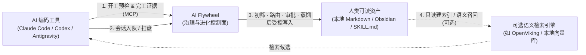
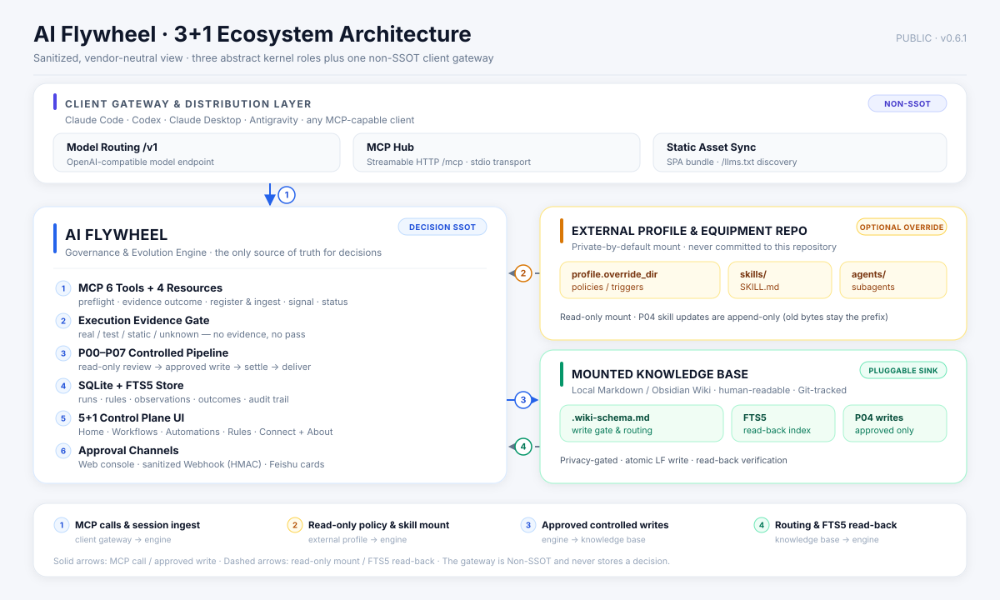

# AI Flywheel

> **面向多 AI 编码工具的本地优先「治理与进化控制面」**
>
> *开工查规矩 · 完工交证据 · 沉淀经审批 · 经验抗腐烂*

**AI Flywheel** 是一个本地优先、方法论策略与知识存储彻底解耦的 **AI 协作治理与进化控制面（Governance & Evolution Control Plane）**。它通过标准 **MCP**（及可选极薄转发 Hook）旁路接入 **Claude Code、Codex、Claude Desktop、Antigravity** 等 AI 编码工具，用**执行期证据门禁 + 后台 P00–P07 受控沉淀流水线 + 抗熵增蒸馏机制**，把日常会话转化为可审计、可复用、不会越攒越乱的规则、本地 Markdown 知识与 `SKILL.md`。

---

## 为什么需要 AI Flywheel？

如果你已经重度使用 AI 编码工具，大概率遇到过这三个真实痛点：

1. **AI 总是反复犯同一个错，而且爱「口头宣称已完成」**
   - 上周刚踩过的坑，换个会话或换个工具照样重犯；交付时没有真实测试/运行证据就敢报 `done`。
   - **飞轮的解法**：任务前通过 `flywheel_preflight_activate` 下发反偷懒契约、命中规则与历史反例；交付时通过 `flywheel_record_outcome` 做提交期证据硬门禁（`real / test / static / unknown`），没证据不给过。
2. **自动记忆工具用几个月就成垃圾场，规则越攒越冲突**
   - 很多 AI 记忆工具只管“往里塞”：闲聊也记、一次性报错也记、旧经验永不过期、新例外静默覆盖旧规则，最后上下文越喂越脏。
   - **飞轮的解法**：两级噪音初筛（先硬筛再 AI 价值判定）+ 错题观察池（普通失误满 3 次才晋升规则）+ 分歧反例保留 + 30/90/180 天新鲜度衰减 + 周五自动蒸馏淘汰僵尸规则与表演型 Skill。
3. **不敢让后台模型静默改写你的知识库和 `SKILL.md`**
   - 怕密钥写进笔记、怕模型乱塞目录、怕覆盖掉辛苦写好的 Skill、怕坏输出静默污染资产。
   - **飞轮的解法**：P02/P03 严格只读、审批后 P04 唯一受控写入；Schema 路由契约找不到归属宁可不写；写前密钥硬拦截；Skill 更新永远只追加不重写；安全阀对自动审批拥有最终否决权。

---

## 与上下文数据库 / AI Memory 工具（如 OpenViking、Mem0）的区别

**AI Flywheel 不是另一个向量库或黑盒记忆数据库，而是站在它们上游/侧面的「治理与进化控制面」。两者是正交互补关系，不是替代关系：**

| 维度 | 上下文数据库 / Memory 引擎（如 OpenViking、Mem0） | AI Flywheel（治理与进化控制面） |
|---|---|---|
| **核心问题** | 解决「记性问题」：怎么存得全、查得准、省 Token | 解决「守规矩 + 长记性问题」：怎么防复发、控写入、抗腐烂、验真伪 |
| **核心抽象** | 向量库 / 虚拟文件系统（如 `viking://`）+ 分层检索 | 执行期证据契约 + P00–P07 受控状态机 + 规则/经验生命周期 |
| **写入哲学** | 低摩擦、异步自动抽取写入内部存储 | 高门槛受控写入：初筛 → 路由校验 → 隐私拦截 → 人机审批 → 原子落盘 |
| **抗熵增治理** | 偏增量沉淀 | 事不过三晋升、反例不覆盖、时效衰减、周五蒸馏、Skill 实效账本 |
| **执行期约束** | 只提供上下文召回，不约束交付质量 | 任务前强制预检（Preflight），任务后证据门禁（Outcome Gate） |
| **资产归属** | 收敛在引擎内部库 | 零锁定：直接写入人类可读、可进 Git 的 Markdown / Obsidian / `SKILL.md` |



---

## 3+1 通用生态架构



AI Flywheel 采用「**3+1**」通用生态定位：最外层是一个不持有事实源的**客户端网关与分发层**（Model Routing `/v1` · MCP Hub · Static Asset Sync，明确标注 **Non-SSOT**），面向 Claude Code、Codex、Claude Desktop、Antigravity 等 AI 客户端；其内是三个可独立治理的内核角色：

- **AI Flywheel（治理与进化引擎）**：MCP 7 Tools + 4 Resources、执行期证据门禁、显式沉淀队列（`distill_queue` + 统一字典表 + 通用轨迹）、P00–P07 受控流水线、SQLite FTS5、5+1 控制面与多通道审批——所有决策事实源的唯一归属。
- **外部策略与装备仓（可选覆盖）**：通过 `profile.override_dir` 只读挂载 policies / triggers、`skills/` 与 `agents/`；P04 对 `SKILL.md` 只做追加式更新（旧文件逐字节为新文件前缀）。
- **挂载知识库（本地 Markdown / Obsidian Wiki）**：人类可读、可进 Git 的知识资产；`.wiki-schema.md` 写入门禁、FTS5 回读索引与 P04 审批后受控写入。

> **v0.7.0 更新指引**：新增显式**沉淀队列机制（`distill_queue`）与数据建模底座（SQLite v4）**——统一码值字典表 `sys_dict_items`（`GET /api/site/dicts`）、复用 `audit_events` 作为全系统结构化状态变迁轨迹、落仓权威建模脚本 [`docs/schema.sql`](./docs/schema.sql) 与 [`docs/data-model.md`](./docs/data-model.md)（含不变量测试守护）；实现 **Codex 严格归档制（`archived_sessions` 出现入队/移出撤回/增大增量）**、**Claude Code exit 退出触发（`SessionEnd` 入队 + `resume` 自动撤回）**、第 7 个 MCP 工具 **`flywheel_session_intent`**（对话内一键声明沉淀 / 不沉淀 / 撤回，Hook 透传 `session_key` 精准对齐）、超大上下文 0-Token 瘦身与分片（不丢尾）以及死信隔离（DLQ）；「沉淀与审批」页升级为顶部 6 态库存进度条 + **「沉淀队列（库存）」/「执行流水线（P00–P07）」**双 Tab 控制台。

---

## 工作原理：一条执行闭环 + 一条受控进化流水线

### 1. 执行期闭环（标准 MCP：7 Tools + 4 Resources）

AI 工具通过 `http://127.0.0.1:8765/mcp`（Streamable HTTP）或 `flywheel mcp-stdio` 接入：

- **开工前**：调用 `flywheel_preflight_activate` 获取反偷懒契约、个人协作偏好、命中先例规则及已知反例，并签发不可变预检回执；也可随时读取 `flywheel://core-card`（≤200 行跨端热态索引卡）。
- **执行中**：遇到死循环、高危动作或规则复发时，通过 `flywheel_report_signal` 记入复盘队列；`UserPromptSubmit` Hook 会向模型上下文注入规范 `session=<client>:<session_id>` 标识，确保 MCP 声明与本地归档 100% 对齐。
- **交付时**：调用 `flywheel_record_outcome` 提交结构化验收结果——声明 `status=success` 必须所有必填检查项通过，`real + pass` 必须附带真实证据，并同步回传 `used_knowledge_paths`（自动续期经验卡）与 `used_skills`（记录 Skill 真实调用）。
- **会话入队与显式意图控制**：通过 `flywheel_session_intent`（`enqueue` 显式高优沉淀 / `opt_out` 本会话永久不沉淀 / `withdraw` 撤回排队）、`flywheel_ingest_session`、`flywheel_register_session`，或由 **Codex 归档目录对账 / Claude Code `SessionEnd` 退出钩子**进入 `distill_queue` 库存队列。

### 2. 后台受控进化流水线（P00–P07 固定 8 节点）

每个阶段有严格的**副作用边界**（写越界即视为缺陷），状态机全链路可观测、可中断、可崩溃恢复：

| 阶段 | 名称 | 副作用边界 |
|---|---|---|
| `P00_PREPARE` | 准备与对账 | 一级规则硬筛与会话对账，不触碰知识库 |
| `P01_BEGIN` | 独占启动 | 抢占批次独占锁，按预算准入待审会话 |
| `P02_REVIEW` | 全文审查 | **严格只读**：AI 语义价值闸门过滤闲聊，产出错题与分歧*候选*（不入库） |
| `P03_ROUTE_PLAN` | 路由与写入计划 | **严格只读**：基于 `.wiki-schema.md` 候选集与证据生成写入计划 |
| `P04_WRITE_VERIFY` | 受控写入与验收 | **唯一受控写入阶段**：审批通过后执行隐私门 → Schema 门 → 原子写入 → 回读校验 |
| `P05_SETTLE` | 台账与队列结算 | 幂等结算会话状态、整批仅重建一次 FTS5、刷新派生核心索引卡 |
| `P06_REPORT` | 机器报告与摘要 | 生成批次摘要与审计报告，不触碰知识库 |
| `P07_DELIVER` | 交付与终态释锁 | 推送通知 / 审批卡片，释放独占锁 |

> **失败与拒绝契约**：任意节点失败时，下游节点显式 `SKIPPED`、已准入会话退回 `pending`、锁释放且批次终态为 `FAILED`；审批被拒终态为 `CANCELLED`，与写了一半的 `PARTIAL` 严格区分。

---

## 核心能力（v0.7.0）

### 1. 策略与知识解耦 + 执行期实证门禁
- 反偷懒契约、循环保护阈值、证据分级（`real / test / static / unknown`）与个人协作偏好独立托管在 `profile/policies/`，无需绑定特定知识库。
- 知识落点完全可插拔：默认内置 `./data/knowledge`（零配置开箱即用），也可无侵入挂载任意本地 Markdown / Obsidian Wiki。

### 2. 显式沉淀队列、双端归档机制与统一数据底座（v0.7.0）
- **可见的流水线库存（`distill_queue`）**：将客户端会话主档（`sessions`）与流水线沉淀任务解耦，提供 6 态库存（`queued` / `processing` / `processed` / `excluded` / `withdrawn` / `dead_letter`）、按工具分片统计与预计清仓批次数；同一会话支持撤回后再输入增量入队（`rev + 1` 水位线）与独立失败重试/死信隔离。
- **双端精准触发 + MCP 显式声明**：
  - **Codex（严格归档制）**：仅同步 `archived_sessions/` 归档目录或 MCP 显式声明，移出自动撤回、续聊增大后重归档自动增量入队；
  - **Claude Code（exit 退出触发制）**：`SessionEnd` 过三级规则闸门入队，`SessionStart(resume)` 与续聊提示自动撤回，`Stop` 不再制造半成品噪音；
  - **对话内 MCP 控制**：`flywheel_session_intent` 支持一句话声明沉淀（`enqueue` 高优直通）、本会话永久不沉淀（`opt_out` 一票否决）与撤回（`withdraw`），并由 `UserPromptSubmit` 自动注入规范 `session_key` 实现 100% 对齐。
- **超大上下文 0-Token 瘦身与分片**：入队前保留完整用户提问与尾部结论、折叠冗长工具日志，仍超预算时按轮次边界自动拆片（`chunk 1/N..N/N`），杜绝截尾丢根因。
- **统一字典表 + 通用状态轨迹 + 权威 DDL**：新增 `sys_dict_items` 统一托管 9 类 55 项内置码值与扩展元数据（`GET /api/site/dicts`）；复用 `audit_events` 承接全系统状态变迁轨迹；权威建模脚本 [`docs/schema.sql`](./docs/schema.sql) 与 [`docs/data-model.md`](./docs/data-model.md) 受架构不变量测试强守护。

### 3. 抗熵增进化引擎（防记忆投毒、敢做减法、规则可回溯）
- **两级会话初筛**：一级 0-Token 规则硬筛自动过滤内部子代理碎片与空会话；二级 P02 语义价值闸门直接丢弃翻译、闲聊与一次性问答，绝不硬凑笔记。
- **双轨错题观察池**：失误分 `red_silent`（🔴 沉默错误）/ `yellow_caught`（🟡 自查拦截）/ `green_minor`（🟢 轻微）；普通失误按 `root_cause_key` 聚类满 **3 次（事不过三）** 才晋升规则，高危沉默错误支持首次直通试运行。
- **分歧反例保留 + 轻量规则双时态沿革**：规则复测失败或出现例外时写入 `dissent_records` 绝不静默覆盖；规则替代与停用自动记录 `supersedes_rule_id`、`effective_from`、`effective_to`（纯 SQLite 幂等迁移，无需图库），完整保留规则演进时间线。
- **经验卡新鲜度保鲜**：按 `volatile`（30 天）/ `evolving`（90 天）/ `evergreen`（180 天）管理有效期；超期自动降权并提示复核，在真实任务中通过 `real` 验证引用时自动续期。
- **周五分层蒸馏 + 反 Skill 表演**：支持只读预览（`GET /api/site/dream` / 控制台一键预览）与自动/手动执行——将 14 天零命中试运行规则转入 `dormant`、标记超期经验、检测触发词重合规则及 21 天零调用或连续失败 Skill。

### 4. 人机可控的资产变更、Git 审计与多通道通知
- **合同驱动的 Schema 写入门禁**：挂载含 `.wiki-schema.md` 的 Wiki 时，P03 由模型从现场候选集中声明路由并经证据交叉校验（归属不明或冲突绝不写入，记 `planned_doc_unrouted`）；支持中性 `postflight_hook_script` 写后校验钩子（向后兼容 `wiki_d2_postflight_script`）。
- **写时隐私与密钥门禁**：自动脱敏 `<private>...</private>` 区块（含文件名 slug 剥离），硬拦截 API Key / Token / 私钥（`SecretLeakError`）。
- **Skill 追加式无损更新**：`action="update"` 只在现有 `SKILL.md` 末尾追加新节——旧文件逐字节为新文件前缀，写前备份、原子替换、SHA-256 回读校验并保留原有换行符；审批卡提供现有大纲与全文对照。
- **可选 P04 本地 Git 审计提交**：开启 `knowledge_sink.auto_git_commit: true` 后，P04 写入验收完成时仅对本批写入路径执行 `git commit --only`（带 `run_id` 与审批来源，绝不触碰无关文件、绝不 `push`）。
- **分层审批、安全阀与多通道通知**：支持 `smart` / `always` / `auto` 审批模式，安全阀 `safety_valves.auto_approve_writes = false` 拥有最终否决权；支持 Web 控制台、通用 **Webhook**（隐私脱敏 + 可选 HMAC-SHA256 `X-Flywheel-Signature` 签名 + 非致命投递）以及可选飞书交互卡片审批。

### 5. 工程级可靠性与可观测性
- **反静默回退**：`api` / `cli` 模式下模型输出不可用时节点直接失败并留下原因码与结构化诊断，绝不偷偷退回本地启发式却伪报模型来源。
- **校验后缓存与调用追踪**：仅在回复通过语义校验后写入 `api_cache/`；记录尝试次数、耗时、实际服务模型与 prompt / completion / reasoning token 用量，在控制台节点详情直接透出。
- **原子审批与崩溃恢复**：认领审批、状态迁移与审计事件在同一事务落盘；执行中每 15 秒续锁打心跳，`serve` 进程每 30 秒自动收割僵尸批次。

### 6. 极简 `5+1` 控制面与零摩擦引导 CLI
- **控制面 Web UI**：`今日态势`（实证通过率 / 规则健康 / 错题池 / 实时调度与安全阀 / 核心索引卡）/ `沉淀与审批`（顶部 6 态队列库存进度条 + 「沉淀队列（库存）」与「执行流水线（P00–P07）」双 Tab / 轨迹展开 / 规则重筛预览 / 批量插队与审批抽屉）/ `自动化调度`（上海时区 Cron 热重载 / 周五蒸馏预览与触发 / 守护巡检）/ `规则与进化`（避坑规则含沿革徽标 / 错题与分歧 / Skill 实效与经验保鲜 / 证据台账 / 执行规矩）/ `接入与设置` + `关于`。
- **引导与诊断 CLI**：内置只读环境体检 `flywheel doctor [--json]` 与多端 MCP 配置向导 `flywheel init-client <claude-code|codex|claude-desktop|antigravity> [--apply]`（默认安全 dry-run，应用时自动备份并幂等合并）。

---

## 非目标（What AI Flywheel Does NOT Do）

为了保持清晰边界，AI Flywheel **刻意不做**以下事情：

- **不做重型向量数据库或文档解析器**：内置 SQLite FTS5 只做零依赖轻量兜底，不内嵌 Embedding 运维、PDF/PPT 解析或代码 AST 索引；需要大规模语义检索时，建议将治理后的 Markdown 目录交由 OpenViking 等专业检索引擎索引。
- **不做全量聊天记录黑盒记忆库**：不追求记住随口聊天的每一句生活细节，只聚焦高信号工程经验、防复发规则与可复用 Skill。
- **不做通用 Agent Runtime 或聊天机器人框架**：保持无侵入旁路控制面定位，让你继续使用自己顺手的 AI 编码工具。

---

## 快速开始（3 分钟本地启动）

### 1. 环境要求
- Python `3.11+`
- Node.js `20+`（仅构建前端静态资源需要）

### 2. 安装与构建

```bash
git clone https://github.com/BonusWang/ai-flywheel.git
cd ai-flywheel

python -m venv .venv
# Windows PowerShell:
.\.venv\Scripts\Activate.ps1
# macOS / Linux:
# source .venv/bin/activate

pip install -e ".[dev]"

cd frontend
npm install
npm run build
cd ..
```

### 3. 一键启动与引导自检

```bash
flywheel doctor           # 只读环境与配置自检（支持 --json）
flywheel serve --seed     # 启动本地控制面与 MCP 服务
```

快速生成并合并客户端 MCP 配置（默认安全 dry-run，确认后加 `--apply` 自动备份并合并）：

```bash
flywheel init-client claude-code
flywheel init-client codex --apply
```

启动后访问：
- **控制面 Web UI**：`http://127.0.0.1:8765`
- **MCP Streamable HTTP 端点**：`http://127.0.0.1:8765/mcp`
- **Agent 发现文档**：`http://127.0.0.1:8765/llms.txt`

如需以 `stdio` 模式接入 Claude Desktop 等客户端：

```bash
flywheel mcp-stdio
```

---

## 配置与外部挂载

复制 [`flywheel.yaml.example`](./flywheel.yaml.example) 为 `flywheel.yaml`（已被 `.gitignore` 忽略），即可无侵入挂载私有策略覆盖包、本地 Skills 目录、Markdown / Obsidian Wiki 与 OpenAI 兼容模型端点：

```yaml
profile:
  override_dir: "/path/to/your-private-profile"   # 可选：私有偏好与规则覆盖包

capabilities:
  skills_dirs:
    - "/path/to/your-skills"                      # 可选：本地 SKILL.md 目录

sessions:
  codex_archive_sources:                          # 可选：Codex 严格归档目录（出现入队/移出撤回/增大增量）
    - client: "codex"
      path: "~/.codex/archived_sessions"
      glob: "**/*.jsonl"
  queue_max_item_chars: 24000                     # 超大上下文瘦身后单片字符上限
  queue_max_retries: 3                            # 队列项最大失败重试次数（超限转死信）

knowledge_sink:
  type: "local_markdown_wiki"                     # builtin_kb | local_markdown_wiki
  root: "/path/to/your-wiki"                      # 挂载任意本地 Markdown / Obsidian 目录
  auto_git_commit: false                          # 可选：P04 写完后仅提交本批文件到本地 Git（绝不 push）
  postflight_hook_script: ""                      # 可选：SchemaWriteGate 写后校验脚本（兼容 wiki_d2_postflight_script）

delivery:
  webhook:
    enabled: false                                # 可选：通用 Webhook 通知（隐私脱敏 + HMAC-SHA256 签名）
    url: ""
    secret: ""                                    # 也可通过 FLYWHEEL_WEBHOOK_SECRET 注入
    notify_on_fyi: false

workflow:
  approval_mode: "smart"                          # smart | always | auto
  friday_weekly_enabled: true

runner:
  mode: "api"                                     # dry_run | api | cli
  api:
    base_url: "http://127.0.0.1:8000/v1"          # 任意 OpenAI 兼容端点
    model: "your-model"
    timeout_seconds: 240
    reasoning_effort: ""                          # 留空则不发送该参数
    transport_retries: 1                          # 超时/连接错误即时重试次数

safety_valves:
  auto_approve_writes: false                      # 拥有最终否决权：false 会将 auto 降级为 smart
  model_execution_enabled: null
```

<details>
<summary><strong>可选集成：飞书交互卡片审批（点击展开）</strong></summary>

在手机飞书卡片上直接批准 / 仅批准常规项 / 取消一次沉淀批次，执行结果回写到同一张卡；链路未通过自检或不可信时自动降级为纯文本通知：

```yaml
delivery:
  feishu_cli:
    enabled: true
    command: "lark-cli"        # 需要 lark-cli >= 1.0.64
    identity: "bot"
    user_id: "ou_xxx"          # 私聊接收人 open_id
    notify_on_fyi: false
    interactive: true
    approver_open_ids: []      # 额外审批人（默认 user_id 本人可批）
```

**首次启用三步：**
1. 在飞书开发者后台为应用订阅「卡片回传交互」（`card.action.trigger`，长连接方式）并发布版本。
2. 重启 `flywheel serve`。
3. 运行 `flywheel feishu-check`（或在控制台「接入与设置」页一键触发自检）并在测试卡上点击确认；通过前通知均为纯文本。

**关键安全边界**：仅配置的审批人在目标消息上的首次点击生效；敏感项附带内容哈希与摘录并注明「摘录不等于全文」；同一个飞书应用的卡片监听仅允许一个活跃 `serve` 实例。

</details>

详见 [CHANGELOG.md](./CHANGELOG.md) 了解各版本演进与 SQLite 自动迁移说明。

---

## 开发规范与一键验收

本仓库采用 **OpenSpec** 规格驱动开发（`openspec/specs/` 为现行基线，`openspec/changes/` 管理变更），架构地图、P00–P07 副作用矩阵与不可协商护栏见 [`AGENTS.md`](./AGENTS.md)。

提交或宣称完成前，运行一条命令完成全量门禁（公开仓卫生 → CHANGELOG 检查 → OpenSpec 严格校验 → pytest 含跨层不变量测试 → 前端构建）：

```bash
python scripts/verify_repo.py --frontend
```

---

## License

[MIT](./LICENSE)
