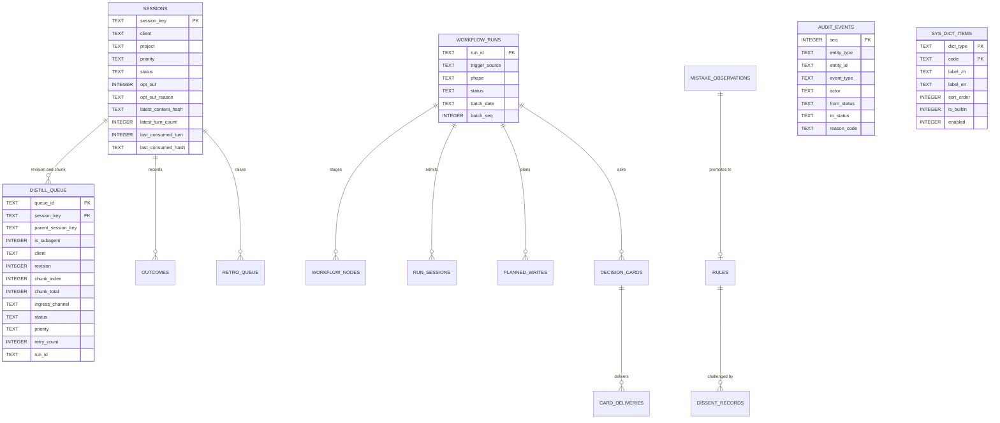

# 数据模型说明（SQLite v4）

> 权威 DDL 见 [`schema.sql`](./schema.sql)。运行时由 `FlywheelDB` 在初始化与迁移时
> 生成同样的表、虚拟表与索引；`tests/test_arch_invariants.py` 会把两份结构逐表逐列
> 比对，任何改了代码却忘了同步文档的改动都会让测试失败。

## 1. 设计原则

1. **实体主档与库存分离**：`sessions` 保存会话身份、退出标记、内容指纹与消费水位线；
   `distill_queue` 保存每一次沉淀工作项（revision / chunk / 重试 / 批次归属）。
2. **枚举是执行契约，字典是展示元数据**：`QueueStatus`、`IngressChannel`、`RunStatus`、
   `RuleStatus`、`SignalKind` 在 Python 枚举里定义状态机边界；`sys_dict_items` 集中托管
   中英文标签、分组、排序与颜色/图标提示，并允许扩展新的分类码值。
3. **一张通用轨迹表**：`audit_events` 是唯一的状态变迁流水，新增
   `from_status`、`to_status`、`reason_code` 三列后，队列、规则、批次与批次内节点
   共用同一套查询方式，不再为每个业务另建 `*_history` 表。
4. **迁移幂等**：所有 DDL 都是 `CREATE TABLE IF NOT EXISTS` / `CREATE INDEX IF NOT EXISTS`，
   新增列走 `_ensure_column`，种子走 `INSERT OR IGNORE`，重复启动零副作用。

## 2. 表目录（按域分组）

### 2.1 会话与沉淀队列

| 表 | 作用 | 关键约束 |
|---|---|---|
| `sessions` | 会话主档：身份、优先级、生命周期状态、`opt_out`、最新内容指纹、已消费水位线 | 主键 `session_key` |
| `distill_queue` | 沉淀工作项库存：同一会话的多 revision 与超大上下文分片 | 主键 `queue_id`；唯一 `(session_key, revision, chunk_index)`；FK `session_key` |
| `retro_queue` | 复盘信号队列（错题线索、重复报错等） | 主键 `retro_id`；`dedupe_key` 唯一 |
| `outcomes` | 任务结果与验证证据 | 主键 `outcome_id` |
| `preflight_receipts` | 任务前置检查回执 | 主键 `receipt_id` |
| `retry_counters` | 通用重试计数 | 主键 `counter_key` |

### 2.2 治理与规则

| 表 | 作用 | 关键约束 |
|---|---|---|
| `rules` | 规则主档，含状态、命中统计与双时态血缘（`supersedes_rule_id` / `effective_*`） | 主键 `rule_id` |
| `mistake_observations` | 错题观察池 | 主键 `obs_id`；`root_cause_key` 唯一 |
| `dissent_records` | 规则 / 知识 / Skill 的分歧记录 | 主键 `dissent_id` |
| `flywheel_metrics_snapshots` | 周期性成长指标快照 | 主键 `snapshot_id`；`period_key` 唯一 |
| `policy_overrides` | 门户对策略的覆盖项 | 主键 `policy_id` |

### 2.3 流水线（P00-P07）与审批

| 表 | 作用 | 关键约束 |
|---|---|---|
| `workflow_runs` | 批次主档：触发源、阶段、运行器、状态、批次日期与序号 | 主键 `run_id` |
| `workflow_nodes` | 批次内每个阶段节点的执行记录 | 主键 `id`；唯一 `(run_id, node_id)`；FK `run_id` |
| `run_sessions` | 批次与获准会话的关联 | 主键 `(run_id, session_key)` |
| `planned_writes` | 受控写入计划与逐项决策 | 主键 `write_id`；FK `run_id` |
| `decision_cards` | 审批 / 询问卡 | 主键 `card_id`；FK `run_id` |
| `card_deliveries` | 卡片的投递台账（含重试、延后与降级状态） | 主键 `delivery_id`；唯一 `(card_id, channel)` |
| `workflow_lock` | 单行独占锁 | 主键固定 `lock_id = 1` |

### 2.4 知识与资产

| 表 | 作用 | 关键约束 |
|---|---|---|
| `knowledge_fts` | FTS5 虚拟表：知识库检索索引 | 虚拟表（unindexed 元数据列 + 分词列） |
| `knowledge_card_metrics` | 知识卡片的表面次数、有效性等级与新鲜度状态 | 主键 `doc_path` |
| `skill_assets` | Skill 台账：调用次数、验证通过次数与健康状态 | 主键 `skill_name` |

### 2.5 系统、字典与统一轨迹

| 表 | 作用 | 关键约束 |
|---|---|---|
| `schema_migrations` | 迁移版本记录（v1-v4） | 主键 `version` |
| `system_settings` | 系统设置（按分类） | 主键 `key` |
| `sys_dict_items` | 统一码值字典 | 联合主键 `(dict_type, code)` |
| `audit_events` | 全系统唯一通用轨迹（含结构化状态变迁） | 主键 `seq`（自增） |

## 3. ER 图



## 4. 内置字典清册（`sys_dict_items`）

`dict_type` 共 9 类。内置项在每次 `FlywheelDB` 初始化时幂等植入；`is_builtin = 0`
的自定义项不会被插入覆盖、更新或删除。

| `dict_type` | 覆盖内容 | 内置 `code` |
|---|---|---|
| `queue_status` | 沉淀队列状态机 | `queued`、`processing`、`processed`、`excluded`、`withdrawn`、`dead_letter` |
| `ingress_channel` | 入队通道 | `mcp_explicit`、`manual_portal`、`codex_archive`、`claude_exit`、`legacy_scan` |
| `exclude_reason` | 排除原因码 | `USER_OPT_OUT`、`SUBAGENT_FRAGMENT`、`EXCLUDED_WORKSPACE`、`TOO_SHORT`、`TEMP_CHAT_LOW_SIGNAL`、`SINGLE_TURN_LOOKUP`、`MANUAL_EXCLUDE`、`EMPTY_DELTA`、`SUPERSEDED`、`HAND_DISTILLED_SKIP` |
| `client_type` | 接入端类型 | `codex`、`claude-code`、`claude`、`antigravity`、`portal-sandbox`、`generic` |
| `priority_level` | 认领优先级 | `P0_CORE`、`P1_SIGNAL`、`P1_GENERAL`、`P2_META` |
| `run_status` | 批次状态机 | `PENDING`、`RUNNING`、`AWAITING_APPROVAL`、`PASS`、`PARTIAL`、`CANCELLED`、`FAILED` |
| `rule_status` | 规则生命周期 | `unverified_active`、`verified_active`、`needs_revision`、`dormant`、`retired` |
| `signal_kind` | 复盘信号种类 | `retry_loop`、`high_risk_tool`、`missing_evidence`、`rule_recurrence`、`blocker`、`custom` |
| `entity_type` | 轨迹实体类型 | `queue_item`、`session`、`workflow_run`、`rule`、`decision_card`、`mistake_observation`、`dissent_record` |

字段约定：

- `sort_order` 升序决定展示顺序；`group_key` 用于前端分组。
- `meta_json` 存放颜色、图标等展示提示（如 `{"color": "blue"}`），序列化为 `meta` 字段。
- `enabled = 0` 表示该码值对前端隐藏；`list_dicts(include_disabled=False)` 默认不返回。
- 自定义扩展只需以 `is_builtin = 0` 写入（`DictRepoMixin.upsert_dict_item`），重启不丢。

只读接口：`GET /api/site/dicts`，可选 `dict_type` 与 `include_disabled` 查询参数，返回
`{"dicts": 分组映射, "items": 扁平列表, "total": 数量}`，均按 `sort_order` 升序。

## 5. `audit_events` 统一状态变迁轨迹规范

所有实体的状态变化都写入同一张 `audit_events`，当前状态仍保存在各业务主表（例如
`distill_queue.status`），避免列表筛选与认领查询引入额外 JOIN。

| 列 | 含义 |
|---|---|
| `seq` | 自增主键，同一实体的轨迹按它排序 |
| `entity_type` | 实体类型，取值见 `entity_type` 字典 |
| `entity_id` | 实体主键 |
| `event_type` | 事件类型，状态变迁固定为 `status_changed` |
| `actor` | 触发者（`system` / `mcp` / 门户用户名等） |
| `summary` | 人类可读摘要 |
| `payload_json` | 结构化载荷（如 `run_id`、`retry_count`） |
| `from_status` | 变迁前状态；非状态事件为空字符串 |
| `to_status` | 变迁后状态；非状态事件为空字符串 |
| `reason_code` | 结构化原因码（如 `USER_WITHDRAW`、`USER_OPT_OUT`） |
| `created_at` | 写入时间 |

写入方式：

```python
db.append_audit_event(
    entity_type="queue_item",
    entity_id="q-1",
    event_type="status_changed",
    from_status="queued",
    to_status="withdrawn",
    reason_code="USER_WITHDRAW",
    actor="mcp",
)
```

向后兼容：`from_status` / `to_status` / `reason_code` 都是可选参数，缺省落为空字符串，
既有调用无需改动。队列状态迁移通过
`update_queue_item_status(...)` 在同一事务内完成状态更新与轨迹写入。

查询：`db.list_audit_events(entity_type=..., entity_id=..., limit=...)` 按 `seq` 倒序返回，
是批次、规则与队列共用的轨迹视图。

## 6. `distill_queue` 多 revision 与分片约定

- 唯一约束 `(session_key, revision, chunk_index)`：同一会话的同一 revision 只允许一条
  同序号分片；不同 revision 或不同分片可以共存。
- `parent_session_key` 与 `is_subagent`：标识子代理会话与其所属主会话的层级归属；带 `parent_session_key` 的子代理记录（`is_subagent = 1`）默认不进入自动批次认领，仅在显式指定 `queue_ids` 时被放行。
- `chunk_total` 记录该 revision 的总分片数；`chunk_index` 从 1 开始。
- `revision` 单调递增，`get_latest_queue_revision(session_key)` 返回当前最高 revision。
- `is_oversized` 标记该 revision 是否因上下文过大被拆分。
- `retry_count` / `max_retries` / `last_error` 支撑独立重试；重试耗尽后进入 `dead_letter`。
- 状态流转：`queued` → `processing` → `processed` / `excluded` / `dead_letter`；
  `queued` / `processing` 均可被 `withdrawn`。终态写入 `completed_at`。
- `summarize_queue(max_sessions_per_run)` 返回：
  - `total`：库存总数；
  - `by_status`：6 个状态的计数（含 0）；
  - `by_client`：按客户端分组的状态计数与 `total`；
  - `by_channel`：5 个入队通道的计数（含 0）；
  - `estimated_batches`：`ceil(queued / max_sessions_per_run)`，无排队任务时为 0。

## 7. 迁移与一致性守护

- v4 迁移记录在 `schema_migrations`：`(4, 'v4_data_foundation_dicts_and_queue')`。
- 存量（v3）数据库首次由新版本打开时，先复制为 `<db>.bak-v3`，再幂等补齐
  `sessions` / `audit_events` 新列、新表与新索引；原有行数据完整保留。
- `docs/schema.sql` 与运行时结构的表集合、逐表列集合由架构不变量测试守护；
  `scripts/verify_repo.py` 的卫生扫描同样覆盖 `.sql` 文件。

